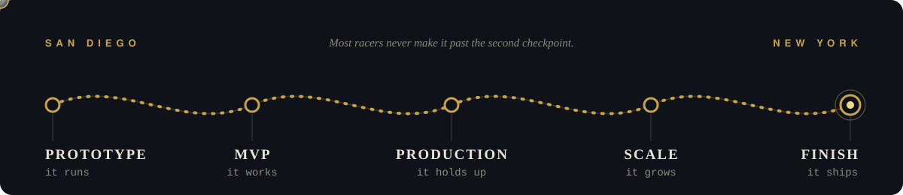
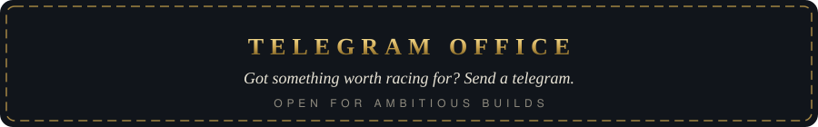

### The Golden Rotation

Most engineers pick one lane and go deep. I run the whole course: APIs, data, ML pipelines, infra, frontends. Same rider, every stage.

The rotation is the point. Build it, spin it, measure it, spin it again. 3–5 years of doing that on things that run in production and don't fall over.

  

  

 

<b>Open the saddlebag (full stack)</b>

 

  

&nbsp;

&nbsp;

&nbsp;

*The race isn't over until the last ball stops spinning.*

